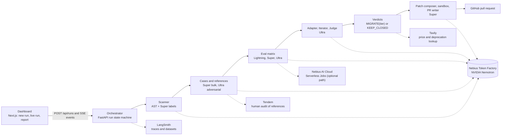

# Offramp

Turns "we should try open models" into a merge-ready pull request: finds every closed-LLM call in a Python repo, proves which ones NVIDIA Nemotron on Nebius Token Factory can take over, and leaves the rest alone when it cannot prove parity.

Built for the Nebius x NVIDIA Global AI Hackathon, track *Coding and Agentic Engineering*. Spec: [docs/PRD.md](docs/PRD.md). Build plan: [docs/plan/PLAN.md](docs/plan/PLAN.md). Feedback on Token Factory and the Nemotron models: [docs/FEEDBACK.md](docs/FEEDBACK.md). Demo video script: [docs/VIDEO.md](docs/VIDEO.md). Devpost text: [docs/SUBMISSION.md](docs/SUBMISSION.md).

**Live demo, no login and no keys:** <https://offramp-seven.vercel.app>. The replay of the recorded run is at [/runs/demo?replay=demo](https://offramp-seven.vercel.app/runs/demo?replay=demo) and its report at [/runs/demo/report?replay=demo](https://offramp-seven.vercel.app/runs/demo/report?replay=demo). The pull request that run opened: [vj-io/offramp-demo-app#1](https://github.com/vj-io/offramp-demo-app/pull/1). Measured outcome: [Results](#results).

**Try it on your own repo, no key:** paste a public GitHub URL at [/scan](https://offramp-seven.vercel.app/scan), or run this in a checkout (needs [uv](https://docs.astral.sh/uv/)):

```bash
uvx --from git+https://github.com/vj-io/offramp offramp scan .
```

Both list every OpenAI, Anthropic, LiteLLM and LangChain call site with its call shape and the list-price ratio of its model to each Nemotron tier (Lightning, Super, Ultra). They read the code and never import or run it, and make no model call. Only a full run, with your own Token Factory key, measures parity.

The same scan over 30 popular public Python repos ([ecosystem scan](docs/evidence/ecosystem-scan.md), 2026-10-21) found 184 call sites in 24 of them. The repos are the most-starred hits of a GitHub search for `openai` and `anthropic` that import either SDK and have an archive under 25 MB; 22 bigger top hits were skipped. Of the 166 chat calls, 17% have a tool-call, JSON or classification shape that Offramp scores deterministically, 84% build their prompt at runtime, 72% have a shape a static scan cannot tell (a full run labels those), and 16% stream (flagged for manual review). 33 of the 50 chat calls that name their model use one its provider has retired or scheduled for shutdown.

## Judges' path: no keys needed

Prerequisites: Python 3.12+ with [uv](https://docs.astral.sh/uv/), Node 20.9+ with [pnpm](https://pnpm.io/), `make`, `curl`.

```bash
git clone https://github.com/vj-io/offramp.git && cd offramp
make demo
```

`make demo` runs `uv sync` and `pnpm install`, starts the API on `:8000` and the dashboard on `:3000`, and opens `http://localhost:3000/runs/demo?replay=demo`. Ctrl-C stops both.

The replay plays the event log of a real run (scan, tier matrix, iterations, verdicts, PR) at 4x speed, gaps capped at 1.5 s. It runs in the browser from `web/public/replay/demo-events.json`, so it needs no backend, no Token Factory key and no network. `make test` runs the whole Python suite on recorded Token Factory responses, also without a key.

Things to look at in the replay: the stage stepper, the sites x tiers heatmap, the verdict on each call-site card (`MIGRATE` with the tier that passed, `KEEP_CLOSED` with the parity it reached, or manual review with the reason), and the "Open the pull request" link on the report page.

## What it does

1. **Scan.** A deterministic AST pass finds `openai`, `anthropic`, `litellm` and LangChain call sites and extracts model, prompt, tools, `response_format`, `stream` and `max_tokens`. Nemotron 3 Super labels each site's contract (classification, JSON extraction, tool call, free text, reasoning). Streaming sites are flagged for manual review and embeddings are flagged, not migrated.
2. **Cases and references.** Each site gets an eval set split into dev and holdout (hash of the case id; the Iterator never sees holdout cases). Expected outputs are references, see "How parity is measured".
3. **Tier matrix.** Every site runs against Nemotron 3.5 Lightning, then Super, then Ultra, on Nebius Token Factory. Deterministic scorers (JSON schema, label, tool name and arguments, numeric answer) come first; an Ultra judge scores free text.
4. **Iterate.** When a cheaper tier fails on dev, an Ultra agent rewrites the adapter (prompt, schema, reasoning budget) and the tier is re-run, up to 3 iterations per tier.
5. **Verdict.** `MIGRATE(tier)` is the cheapest tier that passes on holdout. Otherwise `KEEP_CLOSED(reason)`, with the best tier and its score.
6. **Patch and PR.** Code rewrites each migrated call (the evaluated request as literal keyword arguments) and Nemotron edits only the tests and test fakes that pinned the old provider, so every change to application code is Offramp's own. The repo's own ruff and tests run in a network-off Docker sandbox, and a site whose tests break is downgraded to manual review. The PR carries the evidence table, failing cases, and a "What Offramp did NOT change" section.



## How Nemotron + Token Factory are used

All model calls go through one client, `offramp.tf.client.TFClient`: the OpenAI SDK pointed at `https://api.tokenfactory.nebius.com/v1` with `NEBIUS_API_KEY`. Nothing else is called for inference. Model ids come from `offramp/tf/tiers.py` (override with `OFFRAMP_MODEL_{LIGHTNING,SUPER,ULTRA}`) and were confirmed with `GET /v1/models` ([docs/plan/tf-probe.md](docs/plan/tf-probe.md)):

| Tier | Model id on Token Factory |
|---|---|
| Lightning | `nvidia/Nemotron-3_5-Lightning` |
| Super | `nvidia/nemotron-3-super-120b-a12b` |
| Ultra | `nvidia/Nemotron-3-Ultra-550b-a55b` |

| Agent | Tier | What it does |
|---|---|---|
| Scanner labelling | Super | Labels each call site's contract (task type, output kind, tools, reasoning-heavy) from the code around it |
| Case generator, bulk | Super | Writes realistic inputs that imply an expected output chosen first (seed-first), in batches |
| Case generator, adversarial | Ultra | Writes hard inputs for the same seeds |
| Adapter | Ultra | Translates the closed-model request to Nemotron: tool schemas, `system` mapping, JSON mode versus `json_schema`, reasoning on or off |
| Eval target | Lightning, then Super, then Ultra | The model under test; the cheapest tier that passes wins, which is the point of the product |
| Judge | Ultra | Scores free text 1-5 on an absolute rubric against the evidence, batched per (site, tier, split), pairwise with position swap when a reference answer exists |
| Iterator | Ultra | Rewrites the adapter from up to 10 failing dev cases |
| Verdict text | Super | One-sentence reason beside the rule-based decision |
| Patch composer | Super, Ultra for repairs | Edits the tests and test fakes that pin the old provider; the migrated call itself is rewritten by code, and a model edit to any non-test file is rejected |
| PR writer | Super | Prose only; every number in the PR is rendered by code from the run artifacts |
| Price extraction | Super | Reads source-model prices and deprecation notices out of Tavily search results |
| Reference audit (fallback) | Ultra, thinking on | Blind re-answer of seed references, used only when asked for; see below |

Every structured call uses `temperature=0`, `response_format` `json_schema` (JSON mode plus one repair retry when a tier lacks it), an explicit `chat_template_kwargs.enable_thinking`, a per-agent `max_tokens` cap, and an on-disk cache keyed on `sha256(model, messages, params)`. That cache doubles as the test cassettes. Per-run budget defaults: 1.5M input and 300k output tokens on uncached calls, and at most 40 Ultra agent calls; hitting a cap turns the affected sites into `KEEP_CLOSED("budget ...")`, never a crash.

### Where Token Factory accelerated the workflow

- **One endpoint for three tiers.** Lightning, Super and Ultra sit behind the same OpenAI-compatible API, so the tier matrix is three model ids and the client is the stock OpenAI SDK.
- **Structured output and tool calling on every tier.** `json_schema` and function tools worked on all three in the first capability probe ([docs/plan/tf-probe.md](docs/plan/tf-probe.md)), which is what lets deterministic scorers, not a judge, decide most verdicts.
- **A per-call reasoning switch.** `enable_thinking` turns reasoning off for structured calls and on where the Adapter or a reasoning site needs it.
- **Recorded responses make the repo testable offline.** Live responses are cached as cassettes, so CI and `make test` replay real Token Factory output.
- **What a live run cost.** One full live pipeline (runs 1 and 2 together: eval matrix, iterations, judge and a patch stage) cost $0.83 at list prices by Offramp's spend counter. Each re-run after a fix cost $0.03 to $0.08, because the response cache served every call that had not changed. All four live runs: $0.94 (see [Results](#results)).

What did not work smoothly is written up, with evidence, in [docs/FEEDBACK.md](docs/FEEDBACK.md).

### Other Nebius and partner services

- **Nebius AI Cloud Serverless Jobs** are an optional home for the eval matrix (`offramp/evals/serverless_job`, image `Dockerfile.eval`), submitted with the `nebius` CLI when `NEBIUS_PROJECT_ID` is set and the CLI is installed. That path is built and tested against a fake `nebius` CLI, but it has not been run on a live AI Cloud account (the Token Factory balance cannot fund jobs, see [docs/FEEDBACK.md](docs/FEEDBACK.md)); by default the same matrix runs on an in-process worker with the same output format. AI Cloud billing needs a payment card and a $25 top-up, and this project spends only granted credits, so no job ran on Nebius: every run, the recorded one included, ran its 18-cell matrix on the local worker.
- **Tavily** looks up each source model's published price and deprecation notices at run time. The price feeds the "before" cost, shown as an estimate with its source URL and date; a deprecation notice becomes a sunset-risk badge. A price is accepted only if it is printed on the cited page next to that model's name, otherwise the run falls back to `offramp/evals/pricing.yaml` and says so. In the recorded run, the source-model price for 4 of the 6 sites came from the Tavily lookup and for 2 (`gpt-4o`, `o3`) from the price file, and Tavily found the `claude-sonnet-4-5` retirement notice (30 November 2026) behind the sunset-risk badge on cs_02 and cs_03. Lookups are cached per day: the recorded run read the 2026-10-20 results that run 3 had fetched.
- **LangSmith** (when `LANGSMITH_API_KEY` is set) traces every Token Factory call under `offramp-<run_id>` and keeps each site's cases and references as a dataset, with experiments per tier and split. The recorded run's six public LangSmith links are in the evidence section of its pull request. A run shares nothing by default: the report and the PR link each dataset by its private URL, which opens only for members of your LangSmith workspace, and public share links are made only when `OFFRAMP_LANGSMITH_PUBLIC=1` (the recorded run predates this switch).
- **Tendem** (by Toloka): `scripts/audit_references.py` builds human-audit tasks for flagged references and ingests the verdicts; each paid task needs explicit approval of its quoted price.
- **Toloka** has no API on its current platform, so it is not integrated.
- **Docker** runs the target repo's own `ruff check` and `pytest` on every patch, and the Pydantic models and oracles Offramp reads from it, with the network off and 2 CPUs (see [Security model](#security-model)).
- **Hosting.** The dashboard is on Vercel's free tier and plays the replay in the browser. The same project serves `POST /api/scan`, a Python function that downloads a public repo's tarball and runs the static scanner on it (`web/api/scan.py`; it imports a copy of the scanner modules that `make vendor-scan` writes to `web/pyvendor`, and a test fails if the copy drifts from `offramp/`). The API is not hosted: `make demo` runs it locally, and live runs need your own keys.

## How parity is measured

No OpenAI or Anthropic key was available for the demo, so the source models' own outputs were never recorded. Parity is agreement with **references**, and the PR, the report and the UI say so:

- `reference:seed`: the generator picks the expected output first (label, tool name and arguments, extraction record) and asks Nemotron Super to write an input that implies it.
- `reference:oracle`: deterministic code computes the answer (the demo repo's refund arithmetic).
- `closed_model`: a Claude Sonnet 5.5 subagent run inside the build session answered the exact rendered messages of selected cases. These rows are labelled `claude-sonnet-5.5 (via Claude Code; not the repo's source model)` and carry no latency or cost. They give free-text sites a reference answer and serve as the blind auditor of the seed references, so Nemotron never grades its own gold.
- `reference:human`: written or verified by a person (Tendem), optional.

Pass rules per site, tier and split, as the fraction of passing cases: JSON extraction needs 100% schema-valid and 95% field match; classification 95% label agreement; tool call 95% (tool name and normalised arguments; arguments that are free text are checked for presence, not wording, and the PR says which); reasoning 90% final-answer match; free text needs a judge mean of at least 4.0 and, when a reference exists, within 0.3 of the reference mean. Thresholds are configurable per run. The final verdict uses the holdout split only. Cost "before" is an estimate (published price times tokens measured on the Token Factory call for the same prompt); latency "before" is not measured and shown as "-".
Those measured tokens include Nemotron's reasoning tokens where the evaluated adapter had reasoning on, which raises "before": in the recorded run that is cs_05 only (its Lightning adapter reasons), a manual-review site, so it sits on both sides of the all-sites cost figure and outside the migrated-sites one.

## Results

<!-- Provenance: every number in this section comes from run 20261020-124700775-6cb31e: the replay events (web/public/replay/demo-events.json), the PR body (offramp/api/replay/demo-events.pr.md, also https://github.com/vj-io/offramp-demo-app/pull/1) and evals/results/*.json in vj-io/offramp-demo-app at e5baa78. Spend comes from each run's budget.json (run directories are not committed). -->

The recorded run `20261020-124700775-6cb31e` (2026-10-20) pointed Offramp at [vj-io/offramp-demo-app](https://github.com/vj-io/offramp-demo-app) at commit `0271e58`: a small support-desk app with six chat call sites on OpenAI and Anthropic models, plus one embedding call that is reported and not evaluated. Offramp evaluated 121 cases with references, 40 of them in the holdout split, and opened [pull request #1](https://github.com/vj-io/offramp-demo-app/pull/1) (11 files, +258 / −60). The per-site results, verdicts and adapters are committed in the demo repo under [`evals/results/`](https://github.com/vj-io/offramp-demo-app/tree/e5baa78/evals/results).

**Every site reached the parity bar on a Nemotron tier, on holdout. Three were migrated and three went to manual review**, because the model's test edits for them could not be verified. Offramp writes every change to application code itself; Nemotron edits only tests and test fakes.

| Site and file (demo repo) | Task | Source model | Cheapest tier that passed (holdout) | Parity vs reference (holdout cases) | Outcome |
|---|---|---|---|---|---|
| cs_01 `helphub/inbox/triage.py` | classification | gpt-4o-mini | Lightning, after 1 adapter iteration | 100.0% (9) | Manual review: the model's test edit did not apply (its search text was not in the demo repo's `tests/test_triage.py`) |
| cs_02 `helphub/ops/agent_step.py` | tool call | claude-sonnet-4-5 | Super | 100.0% (5) | **Migrated** to Nemotron 3 Super |
| cs_03 `helphub/orders/extract.py` | JSON extraction | claude-sonnet-4-5 | Super, after 1 iteration | 100.0% (3) | Manual review: the model's test edit fed an Anthropic `TextBlock` into the OpenAI fake, so the repo's tests failed |
| cs_04 `helphub/qa/rag_answer.py` | free text | gpt-4o | Ultra, after 1 iteration | 100.0%, judge mean 5/5 (9) | **Migrated** to Nemotron 3 Ultra |
| cs_05 `helphub/refunds/plan.py` | reasoning | o3 | Lightning | 100.0% (6) | Manual review: its patch would delete a test, which Offramp refuses |
| cs_06 `helphub/summaries/summarize.py` | free text | claude-haiku-4-5 | Lightning, after 1 iteration | 75.0%, judge mean 4.54/5 (8) | **Migrated** to Nemotron 3.5 Lightning |

- **The pass rule for free text is the judge mean** (at least 4.0, and no more than 0.3 below the references' mean). cs_06 passed on a mean of 4.54; 2 of its 8 holdout cases scored below 4 (3.67 and 3.00), and the PR lists both.
- **Iterations.** The Ultra Iterator rewrote an adapter 16 times. cs_04 needed Ultra: 3 rewrites each on Lightning and Super did not reach the bar, and Ultra passed after 1.
- **Holdouts are small** (3 to 9 cases per site), so one miss moves a site's parity by 11 to 33 points. The report shows n for every site.
- **References.** cs_01 to cs_03 use seed references, audited blind by Claude Sonnet 5.5 (checked / agreed / dropped: 24 / 21 / 3, 20 / 15 / 5, 19 / 16 / 3). cs_05 uses the oracle. The free-text references for cs_04 and cs_06 were written by Claude Sonnet 5.5 via Claude Code, not by the repo's source models, whose outputs were never recorded.
- **Cost, estimated per 1,000 calls.** Across all six sites: $49.24 → $43.86 (−11%), the report's headline, with the three manual-review sites still counted at their source-model price. Across the three migrated sites only: $6.54 → $1.15 (−82%), the figure in the PR title. "Before" is a published price times tokens measured on the Token Factory call.
- **Latency on Nemotron, p50 over the holdout cases:** cs_02 2.7 s on Super, cs_04 3.0 s on Ultra, cs_06 3.4 s on Lightning. Latency before was not measured.
- **Sandbox.** The three patches passed the demo repo's own ruff and pytest in Docker, alone and merged.

**What the run cost.** The recorded run replayed every model call from the cache, so its own budget shows $0.00; that is not the cost of the work. The calls were made and paid for by four earlier live runs of the same pipeline. Spend is Offramp's counter: tokens times the Token Factory list prices in `offramp/evals/pricing.yaml`, on calls not served from the cache. Those list prices are unverified, because the price page is login-gated ([FEEDBACK](docs/FEEDBACK.md) item 7), and the counter charges cached input tokens in full, so it may overstate the bill.

| Run | What it did | Input / output tokens | Ultra agent calls | Spend |
|---|---|---|---|---|
| `20261019-220847641-43d3df` | first live run; stopped when the judge skipped a case ([FEEDBACK](docs/FEEDBACK.md) item 11); the next run reused its responses | 355,556 / 237,923 | 26 | $0.50 |
| `20261019-222942730-2c0f0b` | the evaluation the demo uses, plus a patch stage that was later redone | 333,721 / 106,577 | 30 | $0.33 |
| `20261020-115200254-46f068` | the patch stage with code-written call sites | 92,392 / 8,498 | 4 | $0.08 |
| `20261020-122354830-57c50b` | one more repair for each failing site | 24,171 / 4,032 | 2 | $0.03 |
| `20261020-124700775-6cb31e` | the recorded run: everything from the cache, then the PR | 0 / 0 | 0 | $0.00 |

Total: $0.94. Not included: generating the cases and seed references (`offramp prepare`) and the recordings made while developing each agent.

## Run it with your own keys

```bash
cp .env.example .env     # then fill in the keys you have
make install
```

| Variable | Purpose |
|---|---|
| `NEBIUS_API_KEY` | Token Factory key. Required for live runs, not for replay or tests |
| `NEBIUS_BASE_URL` | Defaults to `https://api.tokenfactory.nebius.com/v1` |
| `OFFRAMP_MODEL_LIGHTNING`, `OFFRAMP_MODEL_SUPER`, `OFFRAMP_MODEL_ULTRA` | Tier to model id overrides |
| `GITHUB_TOKEN` | Opening the PR (fine-grained token, contents and pull requests on the target repo only); without it, the local `gh auth token` |
| `OFFRAMP_DEMO_REPO` | The repo the dashboard's "Use demo repo" button fills in, read when the web app is built (default `vj-io/offramp-demo-app`); it has no effect on opening PRs |
| `TAVILY_API_KEY` | Price and deprecation lookup; without it prices come from `pricing.yaml` |
| `LANGSMITH_API_KEY`, `LANGSMITH_TRACING` | Datasets and experiments with the key; traces too when `LANGSMITH_TRACING=true` |
| `LANGSMITH_PROJECT` | LangSmith's own default project, for traces made outside a run (`offramp prepare`); `offramp run` traces each run to its own project, `offramp-<run_id>` |
| `OFFRAMP_LANGSMITH_PUBLIC` | `1` makes the report and PR link public, read-only LangSmith share links of each site's dataset (its prompts, inputs and references). Unset, nothing is shared and the links are the datasets' private URLs |
| `TENDEM_API_KEY` | Not read by Offramp's code: `scripts/audit_references.py` writes the human-audit task and reads the verdicts back as files, and posting the task to Tendem is a manual step |
| `NEBIUS_PROJECT_ID`, `OFFRAMP_EVAL_IMAGE` | Submit the eval matrix as a Serverless Job instead of running it locally (needs an AI Cloud account) |
| `OFFRAMP_DATA_DIR`, `OFFRAMP_RATE_LIMIT_PER_MIN`, `OFFRAMP_WEB_ORIGIN`, `OFFRAMP_ALLOW_LIVE_RUNS` | API data directory, rate limit on `POST /api/runs`, allowed web origin for CORS, opt-in for any run through the API, cache-only or live (off by default; replays need none) |
| `OFFRAMP_ALLOW_LOCAL_SANDBOX` | `1` lets target-repo code run on this machine when Docker is unavailable: not isolated, for repos you trust (see [Security model](#security-model)) |
| `*_FALLBACK` (Nebius, Tavily, LangSmith) | Second key, used for the rest of the process when the primary is rejected or out of credit; the switch is logged without the key |

`.env` is gitignored, keys are read server-side only, and CI scans the full history with gitleaks.

### Security model

- **What runs where.** Offramp runs code from the repo it is given in three places: the repo's own `ruff` and `pytest` on each patch, the Pydantic models it imports to read their JSON schemas, and the oracles in `evals/reference/`. All three run in the Docker sandbox (`offramp/sandbox.py`). The repo's dependencies are installed when the sandbox image is built, inside Docker; the code then runs with the network off, the repo mounted read-only, no capabilities, and none of this machine's environment variables. Everything else (scanning, Token Factory calls, scoring, the PR) runs in the Offramp process and only reads the repo.
- **What never sees keys.** Target code never gets a Token Factory, Tavily, LangSmith or GitHub key: the container receives no host environment. Run events, the PR body and the report are scrubbed of the value of every variable whose name holds KEY, TOKEN, SECRET or PASSWORD before they are stored or sent. LangSmith datasets hold the target's prompts and inputs, and stay private unless `OFFRAMP_LANGSMITH_PUBLIC=1`.
- **Opt-ins.** Without Docker, target code runs only when `OFFRAMP_ALLOW_LOCAL_SANDBOX=1`, as a subprocess on this machine whose environment holds no key or token. That is not isolation: the code runs as you, with your files and your network, so use it only on repos you trust. Without Docker and without the opt-in nothing from the target repo runs: `offramp run` and `offramp prepare` stop with a message saying so when a site needs a schema or an oracle, and the patch stage sends its sites to manual review ("no sandbox"). The API starts runs only with `OFFRAMP_ALLOW_LIVE_RUNS=1` and has no authentication, so bind it to localhost.

```bash
uv run offramp scan <path> [--json]            # call-site table, no key and no model calls; --json for the full scan
uv run offramp prepare <path>                  # generate cases and references into the target repo's evals/
uv run offramp run <repo> [--no-pr] [--cache-only]
uv run offramp serve                           # the API
uv run offramp export-replay <run_id>          # write the replay files from a real run
```

The API contract the dashboard depends on:

| Endpoint | |
|---|---|
| `POST /api/runs` | Body is the run config; returns `{"run_id"}`. `?replay=demo` starts a replay with no Token Factory calls. Every run, cache-only (`"live": false`) included, answers 403 unless the server sets `OFFRAMP_ALLOW_LIVE_RUNS=1`, because a run clones the repo it is given, runs its code in the sandbox and can open a pull request with the server's GitHub token; replays are always allowed. Repo URLs must be `https://` with no credentials (422). 30 requests per minute per IP |
| `GET /api/runs/{id}` | Snapshot: stage, sites, tier results, verdicts, case summaries, totals, artifacts |
| `GET /api/runs/{id}/events` | Server-sent events, resumable with `Last-Event-ID` |
| `GET /api/runs/{id}/report` | JSON download of the snapshot and the PR body |
| `GET /api/health` | `{"ok": true, "tf_configured": bool}` |

### Docker

```bash
docker build -t offramp-api .
docker run --rm -p 127.0.0.1:8000:8000 -v offramp-data:/data --env-file .env offramp-api
```

The image serves the API only; the dashboard in `web/` deploys separately. The API has no authentication and serves every run on its disk, so publish it on localhost only, as above. `Dockerfile.eval` is the Serverless Job image.

## Development

```bash
make help       # all targets
make ci         # ruff, pytest with the coverage gate, web lint, test and build: what CI runs
make live       # delete the recorded cassettes, then re-record them against Token Factory (needs NEBIUS_API_KEY, spends credit; git checkout tests/fixtures/cassettes restores)
```

- Python 3.12, `uv`, ruff; tests under `tests/{unit,agents,harness,integration,e2e}`. Tests marked `live` run only with `--live`.
- CI (`.github/workflows/ci.yml`): ruff, pytest with `--cov=offramp --cov-fail-under=70`, web test, lint and build, gitleaks over the full history, and a Docker build of the API image.
- A live-check workflow (`.github/workflows/nightly-live.yml`) re-records the cassettes against Token Factory and opens an issue when the answers stop satisfying the parsers. Every run spends Token Factory credit, so it runs only when started by hand (`workflow_dispatch`), never on a schedule, and only when the repository has a `NEBIUS_API_KEY` secret.

```
offramp/
  tf/        Token Factory client, cache and cassettes, budgets, tiers
  agents/    scanner, case generator, adapter, judge, iterator, verdict, patcher, PR writer
  evals/     scorers, runner, serverless job, pricing.yaml
  api/       FastAPI orchestrator and replay
web/         Next.js dashboard
docs/        PRD, plan, VIDEO.md, FEEDBACK.md, SUBMISSION.md, media/ (gallery screenshots)
```

## License

MIT, see [LICENSE](LICENSE).
