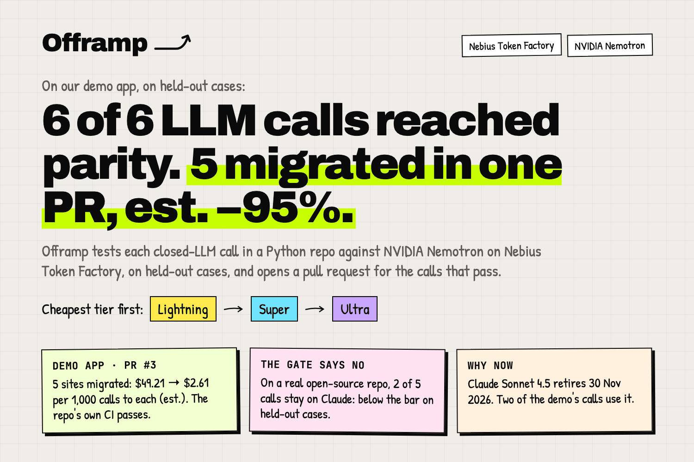
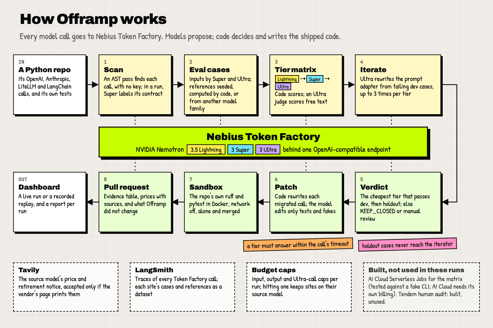

# Offramp

Offramp turns "we should try open models" into a pull request you can review. It tests every closed-LLM call in a Python repo against NVIDIA Nemotron on Nebius Token Factory, and migrates the calls that keep parity on held-out cases.



**On our demo app** (run `20261022-014146107-57cca9`, 2026-10-22):

- **6 of 6 call sites reached the parity bar on a Nemotron tier**, on held-out cases.
- **5 migrated in one pull request, [vj-io/offramp-demo-app#3](https://github.com/vj-io/offramp-demo-app/pull/3).** Estimated cost per 1,000 calls to each site: $49.21 → $2.61 on those 5 (−95%), and $49.24 → $2.65 across all 6 (−95%). One o3 site is most of that; without it, the other five sites (four migrated, plus cs_01 at its source model's price) go from $9.74 to $1.46 (−85%). [Details](#what-it-would-save).
- **The demo repo's own CI passes on that PR.** Offramp also ran the repo's ruff and pytest in a network-off Docker sandbox, per site and merged.
- **1 site went to manual review:** the model's edit to its test would have dropped three asserts, so Offramp refused it.

**Watch it, no login and no keys:** [the demo run](https://offramp-seven.vercel.app/runs/demo?replay=demo) and [its report](https://offramp-seven.vercel.app/runs/demo/report?replay=demo) · [the gate saying no](https://offramp-seven.vercel.app/runs/demo?replay=no-ultra) · [a real open-source repo](https://offramp-seven.vercel.app/runs/demo?replay=oss) and [its PR on our fork](https://github.com/vj-io/idea-reality-mcp/pull/1) · [feedback on Token Factory and Nemotron](docs/FEEDBACK.md) · [Devpost text](docs/SUBMISSION.md)

Built for the Nebius x NVIDIA Global AI Hackathon, track *Coding and Agentic Engineering*.

## Try it

**On your own repo, no key.** Paste a public GitHub URL at [offramp-seven.vercel.app/scan](https://offramp-seven.vercel.app/scan), or run this in a checkout (needs [uv](https://docs.astral.sh/uv/)):

```bash
uvx --from git+https://github.com/vj-io/offramp offramp scan .
```

Both list every OpenAI, Anthropic, LiteLLM and LangChain call site, its call shape, and the list-price ratio of its model to each Nemotron tier. They read the code without importing or running it, and make no model call. Only a full run, with your own Token Factory key, measures parity.

**The recorded run on your machine, no key.** Needs Python 3.12+ with uv, Node 20.9+ with pnpm, `make` and `curl`:

```bash
git clone https://github.com/vj-io/offramp.git && cd offramp
make demo
```

`make demo` installs dependencies, starts the API on `:8000` and the dashboard on `:3000`, and opens the replay. The replay plays a real run's event log in the browser, so it needs no backend call, no key and no network. `make test` runs the Python suite on recorded Token Factory responses, also without a key.

**A full run on your repo** needs a Token Factory key: see [Run it with your own keys](#run-it-with-your-own-keys).

## The gate saying no

Offramp keeps a call on its source model when no Nemotron tier reaches the bar. The main demo run has no such call: every site passed. Two other recorded runs show the gate refusing.

**A team policy: no Ultra.** Run [`20261022-015732734-b5aee2`](https://offramp-seven.vercel.app/runs/demo?replay=no-ultra) re-ran the demo app with only Lightning and Super allowed, for $0.016. The RAG answerer (cs_04, `gpt-4o`), which needed Ultra in the main run, stays on `gpt-4o`. Lightning failed on the dev split after three adapter rewrites. Super failed too: its best dev judge mean was 4.45, more than 0.3 below the references' mean. The other sites came out as in the main run: 4 migrated (est. −96% on those 4) and cs_01 to manual review.

One detail a careful reader will spot: Offramp measured Super's best adapter on the holdout split for the record, and it passed there (judge mean 4.65, lowest case 3.17, 9 cases). The rule needs a dev pass first, so a holdout result cannot overturn a dev failure; otherwise the held-out cases would be choosing the adapter. The one-sentence verdict Super wrote for this site says the held-out cases failed. That sentence is wrong; the code-built numbers beside it are right.

**A real repo.** On the open-source repo below, two of five calls stay on Claude, both on held-out cases:

- `_extract_keywords_via_haiku` stays on `claude-haiku-4-5`. Super passed dev after one rewrite, then scored a judge mean of 4.28 on 11 held-out cases, more than 0.3 below the references' mean. Ultra failed dev at every adapter version.
- `_generate_strategic_analysis` stays on `claude-sonnet-4-20250514`. Super's third rewrite was identical to its second, which had failed dev with a judge mean of 2.78. Its outputs came back from the cache unchanged, yet it passed dev at exactly 4.0: an Offramp bug had deleted a cached judge reply, so the judge was asked again live and scored the same outputs differently. The holdout still failed (3.55 on 6 cases, below the 4.0 floor), so the verdict stands. Ultra failed dev at all four versions (3.31 to 3.77); its second rewrite was also identical to its first and was scored the same way (3.74, against 3.77). Both bugs are fixed: a judge reply is kept when its retry succeeds, and a rewrite identical to one already tried is refused before it is evaluated.

## On a real repo

[`mnemox-ai/idea-reality-mcp`](https://github.com/mnemox-ai/idea-reality-mcp) is an MIT-licensed MCP server we did not write. We forked it to [`vj-io/idea-reality-mcp`](https://github.com/vj-io/idea-reality-mcp) and ran Offramp on the fork; nothing was sent upstream. It has five Anthropic call sites, all async, each building `AsyncAnthropic(timeout=30.0)` inside its function. `offramp prepare` wrote 96 eval cases (32 held out). Claude Sonnet 5.5, through Claude Code, wrote the free-text references blind, from the blind bundle Offramp exports (`python -m offramp.agents.reference_audit --export-blind`): each case's input messages and answer format, never a reference or a Nemotron answer.

Run [`20261022-153359255-7bea7c`](https://offramp-seven.vercel.app/runs/demo?replay=oss), and then `offramp pr` from that finished run, opened [vj-io/idea-reality-mcp#1](https://github.com/vj-io/idea-reality-mcp/pull/1) on the commit it tested.

| Site | Function | Source model | Outcome (holdout) |
|---|---|---|---|
| cs_01 | `api/main.py` `_extract_keywords_via_haiku` | claude-haiku-4-5 | **Kept**: Super judge mean 4.28, lowest 3.66, n=11, more than 0.3 below the references |
| cs_02 | `api/main.py` `_generate_pivot_hints_llm` | claude-haiku-4-5 | **Migrated** to Super: judge mean 4.61, lowest 4.5, n=6; p50 7.25 s |
| cs_03 | `api/main.py` `expand_idea_endpoint` | claude-haiku-4-5 | **Manual review**: the prompt is built at runtime, so there are no eval cases |
| cs_04 | `api/report.py` `_generate_search_angles` | claude-haiku-4-5 | **Migrated** to Super: judge mean 5.0, lowest 5.0, n=9; p50 4.73 s |
| cs_05 | `api/report.py` `_generate_strategic_analysis` | claude-sonnet-4-20250514 | **Kept**: Super judge mean 3.55 < 4.0, lowest 3.16, n=6, after 3 rewrites (the third repeated the second) |

- **Cost on the 2 migrated sites:** $1.61 → $0.35 per 1,000 calls to each site, est. (−78%, the PR title's figure).
- **No cost estimate for cs_05.** Its source model, `claude-sonnet-4-20250514`, is not in `offramp/evals/pricing.yaml`, and the run's Tavily search found no page that prints an unambiguous price for exactly that model. So Offramp did not estimate its cost (its verdict says "no published price found"), and we added no price we could not source. With cs_03, which has no cases, that leaves 3 of the 5 sites in the run's cost total, and the report says so.
- **cs_02 passed by a small margin.** The site rule compares means: 4.61 against a bar of 4.59 (the references' mean of 4.89, minus 0.3). Case by case, only 1 of its 6 held-out answers is within 0.3 of its own reference, which is the "16.7%" in the PR. Five answers scored 4.5 or 4.67 against references at 5.0.
- **Lightning was too slow here.** The repo's client gives up after 30 s. Lightning's dev medians were 64.3 to 97.5 s in this run, measured on 2026-10-22 and served from the cache, so Offramp did not iterate on Lightning for 4 sites. On the demo app on 2026-10-19, Lightning's medians with thinking off were 0.9 to 3.4 s. Both migrated sites answer on Super well inside the timeout. ([FEEDBACK item 19](docs/FEEDBACK.md#19-lightning-was-about-50-times-slower-on-2026-10-22-than-on-2026-10-19).)
- **Checks.** The repo's own pytest passed in Docker with both patches, alone and merged, but no test exercised either migrated function. cs_02's only test module, `tests/test_pivot_hints_llm.py`, starts with `pytest.importorskip("fastapi")`, and the sandbox installs the fork from `pyproject.toml`, which does not install `fastapi`, so the module was skipped before and after the patch. cs_04's function has no test. To run those tests, a maintainer would install `api/requirements.txt`; the tests set only `ANTHROPIC_API_KEY`, while the patched function reads `NEBIUS_API_KEY`, so they would need that set too. Offramp now runs each site's own tests again on the shipped tree and says per site in the PR which ran, or that none did. The repo configures no ruff. No GitHub Actions run has happened on the fork, so the PR shows no checks.
- **The PR is explicit about what it left.** It adds `openai>=1.50` beside `anthropic`, switches the two migrated functions to `NEBIUS_API_KEY`, and lists every other place that still reads `ANTHROPIC_API_KEY`.
- **Spend:** $2.38 of Token Factory credit for three runs and two rounds of case generation.

### What the real repo taught us

The first two runs on this repo stopped before a PR, because each exposed a bug in Offramp. All are fixed, each with tests, and the third run used the fixes.

1. **Repeated eval cases leaked across splits.** `offramp prepare` wrote 96 cases with only 58 distinct inputs; 15 groups of repeats sat in both dev and holdout. It now removes repeats, asks for distinct batches, and refuses a dataset whose splits share an input.
2. **The Ultra budget ran out on the wrong work.** Run 1 ended every free-text site on `KEEP_CLOSED("budget: Ultra agent call cap reached (40)")`: it iterated failing tiers before checking whether any tier passed, and re-judged results it already had. Offramp now secures a passing tier first, reuses matrix judgments, and keeps the evidence on a budget stop.
3. **A degenerate adapter almost shipped.** In run 2 the Ultra Iterator wrote a system prompt that repeats the word `utility` about 750 times and loses one of the source's rules. It passed the metric. A sanity gate now refuses adapters that repeat text far more than the source does, or drop its numbered rules.
4. **Parity ignored the call's own timeout.** The migrated call kept `timeout=30.0`, while Lightning's holdout p50 on that site was 95.2 s, so most production calls would have timed out. A tier now fails when its holdout p50 is over the call's timeout.
5. **A judge reply cut at `max_tokens` stuck.** An Ultra judge batch ran out of room mid-JSON; the cell was left unscored, and a resume would have been served the same cut reply from the cache. The judge now asks once more with twice the room ([FEEDBACK item 20](docs/FEEDBACK.md#20-a-json_schema-reply-cut-at-max_tokens-is-invalid-json)). Run 3 also deleted the reply that did not parse from the cache, even when the retry succeeded. That made the cs_05 rescoring above possible, and run 3 cannot be replayed from the cache, because some deleted requests were never asked again. A reply is now deleted only when its retry fails too.

## What it would save

Every cost figure here is an estimate per 1,000 calls **to each site**: the source model's published price times the tokens measured on the Token Factory call for the same prompt ("before"), and the Token Factory price of the tier that passed ("after"). A team's bill scales with its own call volume and mix, so the right column only multiplies the measured figure by 1,000.

| Scope | Per 1,000 calls to each site (est.) | At 1M calls a month to each site (est.) | Change |
|---|---|---|---|
| Demo app, all 6 sites (the manual-review site stays on its source model) | $49.24 → $2.65 | $49,243 → $2,646 | −95% |
| Demo app, the 5 migrated sites | $49.21 → $2.61 | $49,209 → $2,611 | −95% |
| Demo app, the 5 sites other than cs_05 (o3) | $9.74 → $1.46 | $9,735 → $1,460 | −85% |
| Open-source repo, the 2 migrated sites | $1.61 → $0.35 | $1,614 → $354 | −78% |

The o3 site (cs_05) is $39.51 of the demo's $49.24 "before". Its estimate prices Lightning's measured tokens, reasoning included, at o3's rates, so it is the least certain figure here. That is why the third row leaves it out.

## Why now

- **A real retirement.** At run time, Offramp's Tavily lookup found that Claude Sonnet 4.5 is deprecated and retires on 30 November 2026, on Anthropic's own model page. Two of the demo app's calls (cs_02, cs_03) use it, and both migrated. PR #3 leads with that line.
- **It is common.** A static scan of 30 popular public Python repos found 50 chat calls that name their model; 33 of those use a model its provider has retired (12) or scheduled for shutdown (21) ([ecosystem scan](docs/evidence/ecosystem-scan.md), 2026-10-21).

## How it works



1. **Scan.** A deterministic AST pass finds `openai`, `anthropic`, `litellm` and LangChain call sites and extracts model, prompt, tools, `response_format`, `stream` and `max_tokens`. In a run, Nemotron 3 Super labels each site's contract (classification, JSON extraction, tool call, free text, reasoning). Streaming sites are flagged for manual review, and embeddings are reported, not migrated.
2. **Cases and references.** Each site gets an eval set split into dev and holdout by a hash of the case id. The Iterator never sees holdout cases. Expected outputs are references; see [How parity is measured](#how-parity-is-measured).
3. **Tier matrix.** Every site runs against Nemotron 3.5 Lightning, then Super, then Ultra, on Nebius Token Factory. Deterministic scorers (JSON schema, label, tool name and arguments, numeric answer) come first; an Ultra judge scores free text.
4. **Iterate.** When a cheaper tier fails on dev, an Ultra agent rewrites the adapter (prompt, schema, reasoning switch) and the tier runs again, up to 3 times per tier.
5. **Verdict.** `MIGRATE(tier)` is the cheapest tier that passes dev and then holdout. Otherwise `KEEP_CLOSED(reason)`, with the best tier and its score.
6. **Patch and PR.** Code rewrites each migrated call (the evaluated request as literal keyword arguments), and Nemotron edits only the tests and test fakes that pinned the old provider, so every change to application code is Offramp's own. The repo's own ruff and tests run in a network-off Docker sandbox, and a site whose tests break goes to manual review. The PR says, per site, which of its tests ran on the patched code, or that none did. The PR carries the evidence table, failing cases, prices with their sources, and a "What Offramp did NOT change" section.

## How Nemotron + Token Factory are used

Offramp's code calls only Token Factory for inference, through one client, `offramp.tf.client.TFClient`: the OpenAI SDK pointed at `https://api.tokenfactory.nebius.com/v1` with `NEBIUS_API_KEY`. The free-text references for the demo and the open-source repo were written separately, in Claude Code by Claude Sonnet 5.5, a different model family (see [How parity is measured](#how-parity-is-measured)). Model ids come from `offramp/tf/tiers.py` (override with `OFFRAMP_MODEL_{LIGHTNING,SUPER,ULTRA}`) and were confirmed with `GET /v1/models` ([docs/plan/tf-probe.md](docs/plan/tf-probe.md)):

| Tier | Model id on Token Factory |
|---|---|
| Lightning | `nvidia/Nemotron-3_5-Lightning` |
| Super | `nvidia/nemotron-3-super-120b-a12b` |
| Ultra | `nvidia/Nemotron-3-Ultra-550b-a55b` |

| Agent | Tier | What it does |
|---|---|---|
| Scanner labelling | Super | Labels each call site's contract (task type, output kind, tools, reasoning-heavy) from the code around it |
| Case generator, bulk | Super | Writes realistic inputs that imply an expected output chosen first (seed-first), in batches |
| Case generator, adversarial | Ultra | Writes hard inputs for the same seeds |
| Adapter | Ultra | Translates the closed-model request to Nemotron: tool schemas, `system` mapping, JSON mode versus `json_schema`, reasoning on or off |
| Eval target | Lightning, then Super, then Ultra | The model under test; the cheapest tier that passes wins, which is the point of the product |
| Judge | Ultra | Scores free text 1-5 on an absolute rubric against the evidence, batched per (site, tier, split), pairwise with position swap when a reference answer exists |
| Iterator | Ultra | Rewrites the adapter from up to 10 failing dev cases |
| Verdict text | Super | One-sentence reason beside the rule-based decision |
| Patch composer | Super, Ultra for repairs | Edits the tests and test fakes that pin the old provider; the migrated call itself is rewritten by code, and a model edit to any non-test file is rejected |
| PR writer | Super | Prose only; every number in the PR is rendered by code from the run artifacts |
| Price extraction | Super | Reads source-model prices and deprecation notices out of Tavily results |
| Reference audit (fallback) | Ultra, thinking on | Blind re-answer of seed references, used only when asked for |

Every structured call uses `temperature=0`, `response_format` `json_schema` (JSON mode plus one repair retry when a tier lacks it), an explicit `chat_template_kwargs.enable_thinking`, a per-agent `max_tokens` cap, and an on-disk cache keyed on `sha256(model, messages, params)`. That cache doubles as the test cassettes. Per-run budget defaults: 1.5M input and 300k output tokens on uncached calls, and at most 40 Ultra agent calls; hitting a cap turns the affected sites into `KEEP_CLOSED("budget ...")`, never a crash.

**Token Factory by the numbers.** Over the 1,768 distinct calls Offramp recorded between 2026-10-19 and 2026-10-22, p50 latency was 3.1 s on Lightning, 3.1 s on Super and 3.8 s on Ultra; 0.5% ended on `finish_reason: length`; and 562 of 566 structured replies were valid JSON (the 4 others were cut at `max_tokens`). Those counts miss 5 judge replies from the open-source run 3 that did not match the rubric schema: Offramp asked each batch again with twice the room and deleted the first reply from the cache. Lightning's p95 of 110.8 s comes from one slow day ([FEEDBACK item 19](docs/FEEDBACK.md#19-lightning-was-about-50-times-slower-on-2026-10-22-than-on-2026-10-19)). Failed requests leave no record, so the error rate is unknown. Full tables: [docs/evidence/tf-production.md](docs/evidence/tf-production.md).

### Where Token Factory accelerated the workflow

- **One endpoint for three tiers.** Lightning, Super and Ultra sit behind the same OpenAI-compatible API, so the tier matrix is three model ids and the client is the stock OpenAI SDK.
- **Structured output and tool calling on every tier.** `json_schema` and function tools worked on all three in the first capability probe ([docs/plan/tf-probe.md](docs/plan/tf-probe.md)), which is what lets deterministic scorers, not a judge, decide most verdicts.
- **A per-call reasoning switch.** `enable_thinking` turns reasoning off for structured calls and on where the Adapter or a reasoning site needs it.
- **Recorded responses make the repo testable offline.** Live responses are cached as cassettes, so CI and `make test` replay real Token Factory output.
- **Re-runs are cheap.** The first full live pipeline on the demo app (runs 1 and 2 together) cost $0.83. Each later run reused every cached response that had not changed, so most cost cents, and the final demo run cost $0.00 (see [What it cost](#what-it-cost)).

What did not work smoothly is written up, with evidence, priorities and repro steps, in [docs/FEEDBACK.md](docs/FEEDBACK.md).

### Other Nebius and partner services

- **Nebius AI Cloud Serverless Jobs** are an optional home for the eval matrix (`offramp/evals/serverless_job`, image `Dockerfile.eval`), submitted with the `nebius` CLI when `NEBIUS_PROJECT_ID` is set and the CLI is installed. That path is built and tested against a fake `nebius` CLI, but it has not run on a live AI Cloud account: AI Cloud billing needs a payment card and a $25 top-up, separate from the Token Factory credits, and this project spends only granted credits ([FEEDBACK item 14](docs/FEEDBACK.md#14-token-factory-credits-cannot-fund-ai-cloud-so-we-could-not-run-a-real-serverless-job)). Every run ran its matrix on the in-process worker, which has the same output format; the run logs say so, for example "eval matrix (18 cells) ran locally (nebius job: not configured)".
- **Tavily** looks up each source model's published price and deprecation notices at run time. The price feeds the "before" cost, shown as an estimate with its source URL and date; a deprecation notice becomes a sunset-risk badge. A price is accepted only if it is printed on the cited page next to that model's name, and a citation of a translated page (`/zh-CN/`, `/ru/`) moves to an English page that prints the same price. When the search results print no such price, one Tavily Extract of the vendor's own model page follows, but its price can only confirm the one checked in to `offramp/evals/pricing.yaml`: a different one is reported ("Tavily page … shows $X/$Y; checked-in table $A/$B; not used") and the checked-in price ships. Otherwise the run falls back to `pricing.yaml` and says so. Each verdict keeps the evidence (query, cited URL, the quoted text that prints the price, method, date), and the PR's Prices section shows it. A retirement date in a verified notice puts the site first in the PR's evidence table and leads the PR summary. Lookups are cached per model and UTC day. In the final demo run, all six "before" prices were checked on the vendor's own page on 2026-10-22: two by search (`claude-sonnet-4-5`) and four by Extract confirming the checked-in price. Cache-only runs (`--cache-only`) never call Tavily and take prices from `pricing.yaml`.
- **Token Factory prices.** The "after" prices come from Token Factory's model API (`GET /v1/models?verbose=true`, per-token pricing), read live once a day and labelled "Token Factory model API, <date>", with `pricing.yaml` as a labelled fallback. On 2026-10-21 the API listed exactly the prices in that file: $0.06 / $0.24, $0.30 / $0.90 and $1 / $3 per 1M input / output tokens for Lightning, Super and Ultra.
- **LangSmith** (when `LANGSMITH_API_KEY` is set) traces every Token Factory call under `offramp-<run_id>` and keeps each site's cases and references as a dataset, with experiments per tier and split. A run shares nothing by default: the report and the PR link each dataset by its private URL, which opens only for members of your LangSmith workspace. Public share links are made only when `OFFRAMP_LANGSMITH_PUBLIC=1`; PR #3's links are private.
- **Tendem** (by Toloka): `scripts/audit_references.py` builds human-audit tasks for flagged references and ingests the verdicts; each paid task needs explicit approval of its quoted price. None was run.
- **Toloka** has no API on its current platform, so it is not integrated.
- **Docker** runs the target repo's own `ruff check` (when the repo configures ruff) and `pytest` on every patch, and the Pydantic models and oracles Offramp reads from it, with the network off and 2 CPUs (see [Security model](#security-model)).
- **Hosting.** The dashboard is on Vercel's free tier and plays the recordings in the browser. The same project serves `POST /api/scan`, a Python function that downloads a public repo's tarball and runs the static scanner on it (`web/api/scan.py`; it imports a copy of the scanner modules that `make vendor-scan` writes to `web/pyvendor`, and a test fails if the copy drifts from `offramp/`). Each scan runs in a forked child that may add at most 1 GiB of address space (`RLIMIT_AS`) and is killed after 21.5 s or once its answer passes 4 MB; a repo that hits any of these gets a 413 pointing to the CLI. One scan runs per instance at a time (others get a 503). The API is not hosted: `make demo` runs it locally, and live runs need your own keys.

## How parity is measured

No OpenAI or Anthropic key was available, so the source models' own outputs were never recorded. Parity is agreement with **references**, and the PR, the report and the UI say so:

- `reference:seed`: the generator picks the expected output first (label, tool name and arguments, extraction record) and asks Nemotron Super to write an input that implies it.
- `reference:oracle`: deterministic code computes the answer (the demo repo's refund arithmetic).
- `closed_model`: Claude Sonnet 5.5, run through Claude Code during the build, answered the exact rendered messages of selected cases. These rows are labelled `claude-sonnet-5.5 (via Claude Code; not the repo's source model)` and carry no latency or cost. They give free-text sites a reference answer and serve as the blind auditor of the seed references, so Nemotron never grades its own gold.
- `reference:human`: written or verified by a person (Tendem), optional.

Pass rules per site, tier and split, as the fraction of passing cases: JSON extraction needs 100% schema-valid and 95% field match; classification 95% label agreement; tool call 95% (tool name and normalised arguments; arguments that are free text are checked for presence, not wording, and the PR says which); reasoning 90% final-answer match. Free text needs a judge mean of at least 4.0 and, when a reference exists, a mean no more than 0.3 below the references' mean; on the holdout split no case may score below 3.0 either. A holdout free-text reference the judge scores below 3 is flagged as judged weak in the PR and the report; it stays in the evaluation. When the call sets a timeout, the tier's holdout p50 latency must be within it. Thresholds are configurable per run. A tier must pass dev before its holdout run counts, and the final verdict uses the holdout split only.

Cost "before" is an estimate: the published price times tokens measured on the Token Factory call for the same prompt. Those tokens include Nemotron's reasoning tokens where the evaluated adapter had reasoning on; in the demo that is cs_05 only. Latency "before" is not measured and shows as "-".

## Results in detail

<!-- Provenance: every number in this section comes from run 20261022-014146107-57cca9: the replay events (web/public/replay/demo-events.json), its report and PR body (https://github.com/vj-io/offramp-demo-app/pull/3), and evals/results/*.json in vj-io/offramp-demo-app at 24b97e0 (written from run 20261022-012608016-d7c85b, whose files and verdicts are identical). Spend comes from each run's budget.json (run directories are not committed). -->

The final demo run `20261022-014146107-57cca9` (2026-10-22) pointed Offramp at [vj-io/offramp-demo-app](https://github.com/vj-io/offramp-demo-app) at commit `24b97e0`: a small support-desk app with six chat call sites on OpenAI and Anthropic models, plus one embedding call that is reported and not evaluated. Offramp evaluated 121 cases with references, 40 of them in the holdout split, and opened [pull request #3](https://github.com/vj-io/offramp-demo-app/pull/3) (15 files, +372 / −91). The repo's GitHub Actions CI (ruff and pytest) passes on it. The per-site results, verdicts and adapters are committed in the demo repo under [`evals/results/`](https://github.com/vj-io/offramp-demo-app/tree/24b97e0/evals/results). PRs #1 and #2 came from earlier runs and are closed with a note that #3 supersedes them.

| Site and file (demo repo) | Task | Source model | Cheapest tier that passed (holdout) | Parity vs reference (holdout: passing / cases, Wilson 95% lower bound) | Outcome |
|---|---|---|---|---|---|
| cs_01 `helphub/inbox/triage.py` | classification | gpt-4o-mini | Lightning, after 1 adapter iteration | 100.0% (9/9, ≥70%) | Manual review: the model's edit to `tests/test_triage.py` quoted lines that match no single place there; applied by function name instead, it would drop three asserts its edit never quoted, so Offramp refused it |
| cs_02 `helphub/ops/agent_step.py` | tool call | claude-sonnet-4-5 | Super | 100.0% (5/5, ≥56%) | **Migrated** to Nemotron 3 Super; p50 2.7 s |
| cs_03 `helphub/orders/extract.py` | JSON extraction | claude-sonnet-4-5 | Super, after 1 iteration | 100.0% (3/3 pass, ≥43%) | **Migrated** to Nemotron 3 Super; p50 2.4 s |
| cs_04 `helphub/qa/rag_answer.py` | free text | gpt-4o | Ultra, after 1 iteration | 100.0% (9/9, ≥70%), judge mean 5/5, lowest case 5/5 | **Migrated** to Nemotron 3 Ultra; p50 3.0 s |
| cs_05 `helphub/refunds/plan.py` | reasoning | o3 | Lightning | 100.0% (6/6, ≥60%) | **Migrated** to Nemotron 3.5 Lightning; p50 19.4 s (reasoning on) |
| cs_06 `helphub/summaries/summarize.py` | free text | claude-haiku-4-5 | Lightning, after 1 iteration | 75.0% (6/8, ≥40%), judge mean 4.54/5, lowest case 3/5 | **Migrated** to Nemotron 3.5 Lightning; p50 3.4 s |

- **Cost per 1,000 calls to each site, est.:** cs_01 $0.03 (stays on gpt-4o-mini), cs_02 $3.59 → $0.33, cs_03 $3.17 → $0.28, cs_04 $2.10 → $0.77, cs_05 $39.51 → $1.19, cs_06 $0.84 → $0.046. They add up to the $49.24 → $2.65 above.
- **The pass rule for free text is the judge mean** (at least 4.0, and no more than 0.3 below the references' mean) plus the holdout floor of 3.0 per case. cs_06 passed on a mean of 4.54; 2 of its 8 holdout cases scored below 4 (3.67 and 3.00), and the PR lists both. One of those answers was in Spanish against an English requirement. The judge scored the reference of cs_06:020 at 1/5; the PR and the report flag it as judged weak, and it stays in.
- **Iterations.** Across the six sites, the Ultra Iterator wrote 16 rewrites, 14 of them distinct adapters: cs_04's second and third rewrites on Super were identical to its first. cs_04 needed Ultra: 3 distinct rewrites on Lightning and 1 on Super did not reach the bar, and Ultra passed after 1. (Offramp now refuses a rewrite identical to one already tried, before evaluating it.)
- **Holdouts are small** (3 to 9 cases per site), so one miss moves a site's parity by 11 to 33 points. The Wilson 95% lower bound says how much a result shows: 100% on 9 cases means, with 95% confidence, a true rate of at least 70%; on 3 cases, only at least 43%. More holdout cases buy certainty cheaply: evaluating them costs cents on Lightning.
- **References.** cs_01 to cs_03 use seed references, audited blind by Claude Sonnet 5.5 (checked / agreed / dropped: 24 / 21 / 3, 20 / 15 / 5, 19 / 16 / 3). cs_05 uses the oracle. The free-text references for cs_04 and cs_06 were written by Claude Sonnet 5.5 via Claude Code.
- **Prices.** "Before": each source model's price, checked on the vendor's page through Tavily on 2026-10-22. "After": Token Factory's model API, 2026-10-22.
- **Sandbox and CI.** The five patches passed the demo repo's own ruff and pytest in Docker, each alone and all merged, and the repo's GitHub Actions run passes on PR #3.

## What it cost

Spend is Offramp's counter: tokens on uncached calls times Token Factory's per-token prices. It charges cached input tokens in full, so it may overstate the bill. Values are rounded to the cent; the exact ones are in each run's `budget.json`. A run that replays cached calls pays only for new ones.

| Run | What it did | Spend |
|---|---|---|
| `20261019-220847641-43d3df` | demo app: first live run; stopped when the judge skipped a case ([FEEDBACK item 11](docs/FEEDBACK.md#11-an-ultra-judge-batch-left-a-case-unscored-and-a-cached-retry-repeated-it)); later runs reused its responses | $0.50 |
| `20261019-222942730-2c0f0b` | demo app: the evaluation the demo still uses, plus a patch stage that was later redone | $0.33 |
| `20261020-115200254-46f068` | demo app: the patch stage with code-written call sites | $0.08 |
| `20261020-122354830-57c50b` | demo app: one more repair for each failing site | $0.03 |
| `20261020-124700775-6cb31e` | demo app: opened PR #1 from the cache | $0.00 |
| `20261021-010850445-554f5f` | demo app: new patcher and price checks | $0.08 |
| `20261021-121928793-c6ae9e` | demo app: after the repair fix | $0.12 |
| `20261022-005412408-1240bf` | demo app: after the import clean-up; 5 of 6 patched | $0.02 |
| `20261022-011012152-704127` | demo app: cache only; opened PR #2 | $0.00 |
| `20261022-012608016-d7c85b` | demo app: the same patch with live price checks, no PR | $0.00 |
| `20261022-014146107-57cca9` | demo app: **the final run**, opened PR #3 | $0.00 |
| `20261022-015732734-b5aee2` | demo app: no-Ultra policy | $0.02 |
| `20261022-023459043-590031` | open-source repo: run 1, stopped on the Ultra cap | $0.64 |
| `20261022-065443547-22ed36` | open-source repo: run 2, stopped before a PR | $0.61 |
| `20261022-153359255-7bea7c` | open-source repo: run 3, PR on the fork | $1.09 |
| | **15 runs** | **$3.51** |

Spent outside those runs and recorded in the build log: $0.49 to record the pipeline test cassettes, $0.05 for the first round of demo case generation, $0.04 to re-record cassettes after a patcher change, and $0.04 for two rounds of case generation on the open-source repo. That makes **$4.13 of the $25 Token Factory grant**. Some development recordings were not logged, so the true total is a little higher.

## Plan versus shipped

The [PRD](docs/PRD.md) was written on 18 October, before any code. This is what changed.

| Planned | Shipped | Why, or what instead |
|---|---|---|
| G1. Find every closed-LLM call site | Yes: OpenAI, Anthropic, LiteLLM and LangChain, by AST | Prompts built at runtime go to manual review; streaming calls are flagged |
| G2. A baseline recorded from the original closed model | No | We had only hackathon credits and no OpenAI or Anthropic key. Parity is against references: seeded, computed by code, or written by Claude Sonnet 5.5. The baseline recorder exists and is tested with fake clients |
| G3. The cheapest tier that passes | Yes | |
| G4. Iterate on failure | Yes, up to 3 Ultra rewrites per tier | A sanity gate for degenerate adapters came from the real repo |
| G5. `MIGRATE` or `KEEP_CLOSED` per site | Yes, plus manual review | The main demo has no `KEEP_CLOSED`, because every site passed. The no-Ultra run and the real repo show it |
| G6. A real PR with evidence | Yes: demo PR #3, with green CI, and PR #1 on the fork | |
| G7. Paste a repo URL, watch it live, get a PR | Partly | Live runs need a local API and your own key. The hosted site plays recordings and runs the keyless scan; hosting full runs needs paid compute, and we spent only granted credits |
| G8. Token Factory and Nemotron impossible to miss | Yes | |
| The eval matrix as a Nebius Serverless Job | Built, not run on Nebius | Tested against a fake CLI. AI Cloud needs separate billing (a card and a $25 top-up) |
| cs_05 as a known-fail canary that must end `KEEP_CLOSED` | No | cs_05 (o3 refund planning, scored against code-computed answers) passed on Lightning in every demo run that reached a verdict. We did not rig it |
| Human audit of references through Tendem | Built, not used | Every paid task needs approval; none was run |
| The API hosted on Nebius | No | Local or Docker only; the web app is on Vercel's free tier |

## Limits

- **Parity is agreement with references,** not with the source model's own answers, which we could not record.
- **Holdouts are small:** 3 to 11 cases per site. Read each result with its Wilson lower bound.
- **The free-text references were written by Claude Sonnet 5.5 in Claude Code,** a step a user cannot repeat with Offramp alone. A team with source-model keys would record its own.
- **"Before" costs are estimates,** and the o3 one leans most on assumptions (see [What it would save](#what-it-would-save)). Latency before migration was not measured.
- **The free-text rule compares means.** A site can pass on its mean while most single answers sit just under their references (the open-source cs_02).
- **Verdict sentences are written by Super and can be wrong.** Every number beside them is rendered by code. The no-Ultra cs_04 sentence is one wrong example.
- **The spend counter may overstate the bill,** and failed requests leave no record, so Token Factory's error rate is unknown.
- **Serverless Jobs never ran on Nebius,** and no CI run exists for the open-source fork.

## Run it with your own keys

```bash
cp .env.example .env
make install
```

Fill in the keys you have in `.env` first.

| Variable | Purpose |
|---|---|
| `NEBIUS_API_KEY` | Token Factory key. Required for live runs, not for replay or tests |
| `NEBIUS_BASE_URL` | Defaults to `https://api.tokenfactory.nebius.com/v1` |
| `OFFRAMP_MODEL_LIGHTNING`, `OFFRAMP_MODEL_SUPER`, `OFFRAMP_MODEL_ULTRA` | Tier to model id overrides |
| `GITHUB_TOKEN` | Opening the PR (fine-grained token, contents and pull requests on the target repo only); without it, the local `gh auth token` |
| `OFFRAMP_DEMO_REPO` | The repo the dashboard's "Use demo repo" button fills in, read when the web app is built (default `vj-io/offramp-demo-app`); it has no effect on opening PRs |
| `TAVILY_API_KEY` | Price and deprecation lookup; without it prices come from `pricing.yaml` |
| `LANGSMITH_API_KEY`, `LANGSMITH_TRACING` | Datasets and experiments with the key; traces too when `LANGSMITH_TRACING=true` |
| `LANGSMITH_PROJECT` | LangSmith's own default project, for traces made outside a run (`offramp prepare`); `offramp run` traces each run to its own project, `offramp-<run_id>` |
| `OFFRAMP_LANGSMITH_PUBLIC` | `1` makes the report and PR link public, read-only LangSmith share links of each site's dataset (its prompts, inputs and references). Unset, nothing is shared and the links are the datasets' private URLs |
| `TENDEM_API_KEY` | Not read by Offramp's code: `scripts/audit_references.py` writes the human-audit task and reads the verdicts back as files, and posting the task to Tendem is a manual step |
| `NEBIUS_PROJECT_ID`, `OFFRAMP_EVAL_IMAGE` | Submit the eval matrix as a Serverless Job instead of running it locally (needs an AI Cloud account) |
| `OFFRAMP_DATA_DIR`, `OFFRAMP_RATE_LIMIT_PER_MIN`, `OFFRAMP_WEB_ORIGIN`, `OFFRAMP_ALLOW_LIVE_RUNS` | API data directory, rate limit on `POST /api/runs`, allowed web origin for CORS, opt-in for any run through the API, cache-only or live (off by default; replays need none) |
| `OFFRAMP_ALLOW_LOCAL_SANDBOX` | `1` lets target-repo code run on this machine when Docker is unavailable: not isolated, for repos you trust (see [Security model](#security-model)) |
| `*_FALLBACK` (Nebius, Tavily, LangSmith) | Second key, used for the rest of the process when the primary is rejected or out of credit; the switch is logged without the key |

`.env` is gitignored, keys are read server-side only, and CI scans the full history with gitleaks.

```bash
uv run offramp scan <path> [--json]
uv run offramp prepare <path>
uv run offramp run <repo> [--no-pr] [--cache-only]
uv run offramp pr <run_id>
uv run offramp serve
uv run offramp export-replay <run_id>
```

In order: the call-site table (no key and no model calls; `--json` for the full scan); generate cases and references into the target repo's `evals/`; a full run; open the pull request from a finished run; the API; write the replay files from a real run.

### Security model

- **What runs where.** Offramp runs code from the repo it is given in three places: the repo's own `ruff` and `pytest` on each patch, the Pydantic models it imports to read their JSON schemas, and the oracles in `evals/reference/`. All three run in the Docker sandbox (`offramp/sandbox.py`). The repo's dependencies are installed when the sandbox image is built, inside Docker; the code then runs with the network off, the repo mounted read-only, no capabilities, and none of this machine's environment variables. Only the repo's tracked files reach the image. Everything else (scanning, Token Factory calls, scoring, the PR) runs in the Offramp process and only reads the repo.
- **What never sees keys.** Target code never gets a Token Factory, Tavily, LangSmith or GitHub key: the container receives no host environment. Run events, the PR body and the report are scrubbed of the value of every variable whose name holds KEY, TOKEN, SECRET or PASSWORD before they are stored or sent. LangSmith datasets hold the target's prompts and inputs, and stay private unless `OFFRAMP_LANGSMITH_PUBLIC=1`.
- **Opt-ins.** Without Docker, target code runs only when `OFFRAMP_ALLOW_LOCAL_SANDBOX=1`, as a subprocess on this machine whose environment holds no key or token, on a copy of the repo's tracked files. That is not isolation: the code runs as you, with your files and your network, so use it only on repos you trust. Without Docker and without the opt-in nothing from the target repo runs: `offramp run` and `offramp prepare` stop with a message saying so when a site needs a schema or an oracle, and the patch stage sends its sites to manual review ("no sandbox"). The API starts runs only with `OFFRAMP_ALLOW_LIVE_RUNS=1` and has no authentication, so bind it to localhost.

The API contract the dashboard depends on:

| Endpoint | |
|---|---|
| `POST /api/runs` | Body is the run config; returns `{"run_id"}`. `?replay=demo` starts a replay with no Token Factory calls. Every run, cache-only (`"live": false`) included, answers 403 unless the server sets `OFFRAMP_ALLOW_LIVE_RUNS=1`, because a run clones the repo it is given, runs its code in the sandbox and can open a pull request with the server's GitHub token; replays are always allowed. Repo URLs must be `https://` with no credentials (422). 30 requests per minute per IP |
| `GET /api/runs/{id}` | Snapshot: stage, sites, tier results, verdicts, case summaries, totals, artifacts |
| `GET /api/runs/{id}/events` | Server-sent events, resumable with `Last-Event-ID` |
| `GET /api/runs/{id}/report` | JSON download of the snapshot and the PR body |
| `GET /api/health` | `{"ok": true, "tf_configured": bool}` |

### Docker

```bash
docker build -t offramp-api .
docker run --rm -p 127.0.0.1:8000:8000 -v offramp-data:/data --env-file .env offramp-api
```

The image serves the API only; the dashboard in `web/` deploys separately. The API has no authentication and serves every run on its disk, so publish it on localhost only, as above. `Dockerfile.eval` is the Serverless Job image.

## Development

```bash
make help
make ci
make live
make sandbox-prune KEEP=10
```

`make help` lists all targets. `make ci` runs what CI runs: ruff, pytest with the coverage gate, and the web lint, test and build. `make live` deletes the recorded cassettes and re-records them against Token Factory (needs `NEBIUS_API_KEY` and spends credit; `git checkout tests/fixtures/cassettes` restores them). Each target tree leaves a cached `offramp-sandbox` image; `make sandbox-prune KEEP=10` removes all but the newest 10 (one a container still uses stays).

- Python 3.12, `uv`, ruff; tests under `tests/{unit,agents,harness,integration,e2e}`. Tests marked `live` run only with `--live`.
- CI (`.github/workflows/ci.yml`): ruff, pytest with `--cov=offramp --cov-fail-under=70`, web test, lint and build, gitleaks over the full history, and a Docker build of the API image.
- A live-check workflow (`.github/workflows/nightly-live.yml`) re-records the cassettes against Token Factory and opens an issue when the answers stop satisfying the parsers. Every run spends Token Factory credit, so it runs only when started by hand (`workflow_dispatch`), never on a schedule, and only when the repository has a `NEBIUS_API_KEY` secret.
- Docs: [PRD](docs/PRD.md), [build plan](docs/plan/PLAN.md), [video script](docs/VIDEO.md), [feedback](docs/FEEDBACK.md), [Devpost text](docs/SUBMISSION.md), [gallery](docs/media/), [evidence](docs/evidence/).

```
offramp/
  tf/        Token Factory client, cache and cassettes, budgets, tiers
  agents/    scanner, case generator, adapter, judge, iterator, verdict, patcher, PR writer
  evals/     scorers, runner, serverless job, pricing.yaml
  api/       FastAPI orchestrator and replay
web/         Next.js dashboard
docs/        PRD, plan, VIDEO.md, FEEDBACK.md, SUBMISSION.md, media/ (gallery), evidence/
```

## License

MIT, see [LICENSE](LICENSE).
