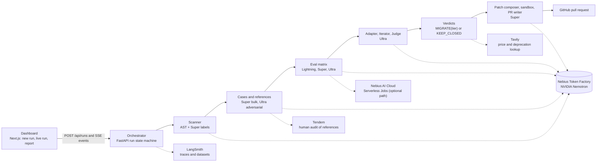

# Offramp

Turns "we should try open models" into a merge-ready pull request: finds every closed-LLM call in a Python repo, proves which ones NVIDIA Nemotron on Nebius Token Factory can take over, and leaves the rest alone when it cannot prove parity.

Built for the Nebius x NVIDIA Global AI Hackathon, track *Coding and Agentic Engineering*. Spec: [docs/PRD.md](docs/PRD.md). Build plan: [docs/plan/PLAN.md](docs/plan/PLAN.md). Feedback on Token Factory and the Nemotron models: [docs/FEEDBACK.md](docs/FEEDBACK.md). Demo video script: [docs/VIDEO.md](docs/VIDEO.md).

<!-- demo-url: filled when the web app is deployed (Task 15) -->

## Judges' path: no keys needed

Prerequisites: Python 3.12+ with [uv](https://docs.astral.sh/uv/), Node 20.9+ with [pnpm](https://pnpm.io/), `make`, `curl`.

```bash
git clone https://github.com/vj-io/offramp.git && cd offramp
make demo
```

`make demo` runs `uv sync` and `pnpm install`, starts the API on `:8000` and the dashboard on `:3000`, and opens `http://localhost:3000/runs/demo?replay=demo`. Ctrl-C stops both.

The replay plays the event log of a real run (scan, tier matrix, iterations, verdicts, PR) at 4x speed, gaps capped at 1.5 s. It runs in the browser from `web/public/replay/demo-events.json`, so it needs no backend, no Token Factory key and no network. `make test` runs the whole Python suite on recorded Token Factory responses, also without a key.

Things to look at in the replay: the stage stepper, the sites x tiers heatmap, the verdict table (per call site either `MIGRATE` with the tier that passed, or `KEEP_CLOSED` with the reason), and the "Open the pull request" link on the report page.

## What it does

1. **Scan.** A deterministic AST pass finds `openai`, `anthropic`, `litellm` and LangChain call sites and extracts model, prompt, tools, `response_format`, `stream` and `max_tokens`. Nemotron 3 Super labels each site's contract (classification, JSON extraction, tool call, free text, reasoning). Streaming sites are flagged for manual review and embeddings are flagged, not migrated.
2. **Cases and references.** Each site gets an eval set split into dev and holdout (hash of the case id; the Iterator never sees holdout cases). Expected outputs are references, see "How parity is measured".
3. **Tier matrix.** Every site runs against Nemotron 3.5 Lightning, then Super, then Ultra, on Nebius Token Factory. Deterministic scorers (JSON schema, label, tool name and arguments, numeric answer) come first; an Ultra judge scores free text.
4. **Iterate.** When a cheaper tier fails on dev, an Ultra agent rewrites the adapter (prompt, schema, reasoning budget) and the tier is re-run, up to 3 iterations per tier.
5. **Verdict.** `MIGRATE(tier)` is the cheapest tier that passes on holdout. Otherwise `KEEP_CLOSED(reason)`, with the best tier and its score.
6. **Patch and PR.** Migrated sites are rewritten, the repo's own ruff and tests run in a network-off Docker sandbox, and a site whose tests break is downgraded to manual review. The PR carries the evidence table, failing cases, and a "What Offramp did NOT change" section.



## How Nemotron + Token Factory are used

All model calls go through one client, `offramp.tf.client.TFClient`: the OpenAI SDK pointed at `https://api.tokenfactory.nebius.com/v1` with `NEBIUS_API_KEY`. Nothing else is called for inference. Model ids come from `offramp/tf/tiers.py` (override with `OFFRAMP_MODEL_{LIGHTNING,SUPER,ULTRA}`) and were confirmed with `GET /v1/models` ([docs/plan/tf-probe.md](docs/plan/tf-probe.md)):

| Tier | Model id on Token Factory |
|---|---|
| Lightning | `nvidia/Nemotron-3_5-Lightning` |
| Super | `nvidia/nemotron-3-super-120b-a12b` |
| Ultra | `nvidia/Nemotron-3-Ultra-550b-a55b` |

| Agent | Tier | What it does |
|---|---|---|
| Scanner labelling | Super | Labels each call site's contract (task type, output kind, tools, reasoning-heavy) from the code around it |
| Case generator, bulk | Super | Writes realistic inputs that imply an expected output chosen first (seed-first), in batches |
| Case generator, adversarial | Ultra | Writes hard inputs for the same seeds |
| Adapter | Ultra | Translates the closed-model request to Nemotron: tool schemas, `system` mapping, JSON mode versus `json_schema`, reasoning on or off |
| Eval target | Lightning, then Super, then Ultra | The model under test; the cheapest tier that passes wins, which is the point of the product |
| Judge | Ultra | Scores free text 1-5 on an absolute rubric against the evidence, batched per (site, tier, split), pairwise with position swap when a reference answer exists |
| Iterator | Ultra | Rewrites the adapter from up to 10 failing dev cases |
| Verdict text | Super | One-sentence reason beside the rule-based decision |
| Patch composer | Super | Rewrites each migrated call and the tests that pin the old provider |
| PR writer | Super | Prose only; every number in the PR is rendered by code from the run artifacts |
| Price extraction | Super | Reads source-model prices and deprecation notices out of Tavily search results |
| Reference audit (fallback) | Ultra, thinking on | Blind re-answer of seed references, used only when asked for; see below |

Every structured call uses `temperature=0`, `response_format` `json_schema` (JSON mode plus one repair retry when a tier lacks it), an explicit `chat_template_kwargs.enable_thinking`, a per-agent `max_tokens` cap, and an on-disk cache keyed on `sha256(model, messages, params)`. That cache doubles as the test cassettes. Per-run budget defaults: 1.5M input and 300k output tokens on uncached calls, and at most 40 Ultra agent calls; hitting a cap turns the affected sites into `KEEP_CLOSED("budget ...")`, never a crash.

### Where Token Factory accelerated the workflow

- **One endpoint for three tiers.** Lightning, Super and Ultra sit behind the same OpenAI-compatible API, so the tier matrix is three model ids and the client is the stock OpenAI SDK.
- **Structured output and tool calling on every tier.** `json_schema` and function tools worked on all three in the first capability probe ([docs/plan/tf-probe.md](docs/plan/tf-probe.md)), which is what lets deterministic scorers, not a judge, decide most verdicts.
- **A per-call reasoning switch.** `enable_thinking` turns reasoning off for structured calls and on where the Adapter or a reasoning site needs it.
- **Recorded responses make the repo testable offline.** Live responses are cached as cassettes, so CI and `make test` replay real Token Factory output.

What did not work smoothly is written up, with evidence, in [docs/FEEDBACK.md](docs/FEEDBACK.md).

### Other Nebius and partner services

- **Nebius AI Cloud Serverless Jobs** are an optional home for the eval matrix (`offramp/evals/serverless_job`, image `Dockerfile.eval`), submitted with the `nebius` CLI when `NEBIUS_PROJECT_ID` is set and the CLI is installed. That path is built and tested against a fake `nebius` CLI, but it has not been run on a live AI Cloud account (the Token Factory balance cannot fund jobs, see [docs/FEEDBACK.md](docs/FEEDBACK.md)); by default the same matrix runs on an in-process worker with identical output.
- **Tavily** looks up each source model's published price and deprecation notices at run time. The price feeds the "before" cost, shown as an estimate with its source URL and date; a deprecation notice becomes a sunset-risk badge. A price is accepted only if it is printed on the cited page next to that model's name, otherwise the run falls back to `offramp/evals/pricing.yaml` and says so.
- **LangSmith** (when `LANGSMITH_API_KEY` is set) traces every Token Factory call under `offramp-<run_id>` and keeps each site's cases and references as a dataset, with experiments per tier and split.
- **Tendem** (by Toloka): `scripts/audit_references.py` builds human-audit tasks for flagged references and ingests the verdicts; each paid task needs explicit approval of its quoted price.
- **Toloka** has no API on its current platform, so it is not integrated.

## How parity is measured

No OpenAI or Anthropic key was available for the demo, so the source models' own outputs were never recorded. Parity is agreement with **references**, and the PR, the report and the UI say so:

- `reference:seed`: the generator picks the expected output first (label, tool name and arguments, extraction record) and asks Nemotron Super to write an input that implies it.
- `reference:oracle`: deterministic code computes the answer (the demo repo's refund arithmetic).
- `closed_model`: a Claude Sonnet 5.5 subagent run inside the build session answered the exact rendered messages of selected cases. These rows are labelled `claude-sonnet-5.5 (via Claude Code; not the repo's source model)` and carry no latency or cost. They give free-text sites a reference answer and serve as the blind auditor of the seed references, so Nemotron never grades its own gold.
- `reference:human`: written or verified by a person (Tendem), optional.

Pass rules per site, tier and split, as the fraction of passing cases: JSON extraction needs 100% schema-valid and 95% field match; classification 95% label agreement; tool call 95% (tool name and normalised arguments; arguments that are free text are checked for presence, not wording, and the PR says which); reasoning 90% final-answer match; free text needs a judge mean of at least 4.0 and, when a reference exists, within 0.3 of the reference mean. Thresholds are configurable per run. The final verdict uses the holdout split only. Cost "before" is an estimate (published price times tokens measured on the Token Factory call for the same prompt); latency "before" is not measured and shown as "-".

## Results

<!-- results: filled from evals/results after the live run (Task 14) -->

## Run it with your own keys

```bash
cp .env.example .env     # then fill in the keys you have
make install
```

| Variable | Purpose |
|---|---|
| `NEBIUS_API_KEY` | Token Factory key. Required for live runs, not for replay or tests |
| `NEBIUS_BASE_URL` | Defaults to `https://api.tokenfactory.nebius.com/v1` |
| `OFFRAMP_MODEL_LIGHTNING`, `OFFRAMP_MODEL_SUPER`, `OFFRAMP_MODEL_ULTRA` | Tier to model id overrides |
| `GITHUB_TOKEN`, `OFFRAMP_DEMO_REPO` | Opening the PR (fine-grained token, contents and pull requests on the target repo only); `vj-io/offramp-demo-app` is the demo target |
| `TAVILY_API_KEY` | Price and deprecation lookup; without it prices come from `pricing.yaml` |
| `LANGSMITH_API_KEY`, `LANGSMITH_TRACING`, `LANGSMITH_PROJECT` | Tracing and datasets |
| `TENDEM_API_KEY` | Human audit of references |
| `NEBIUS_PROJECT_ID`, `OFFRAMP_EVAL_IMAGE` | Submit the eval matrix as a Serverless Job instead of running it locally (needs an AI Cloud account) |
| `OFFRAMP_DATA_DIR`, `OFFRAMP_RATE_LIMIT_PER_MIN`, `OFFRAMP_WEB_ORIGIN`, `OFFRAMP_ALLOW_LIVE_RUNS` | API data directory, rate limit on `POST /api/runs`, allowed web origin for CORS, opt-in for live runs through the API (off by default) |
| `*_FALLBACK` (Nebius, Tavily, LangSmith, Tendem) | Second key, used for the rest of the process when the primary is rejected or out of credit; the switch is logged without the key |

`.env` is gitignored, keys are read server-side only, and CI scans the full history with gitleaks.

```bash
uv run offramp scan <path>                     # list closed-LLM call sites (no model calls)
uv run offramp prepare <path>                  # generate cases and references into the target repo's evals/
uv run offramp run <repo> [--no-pr] [--cache-only]
uv run offramp serve                           # the API
uv run offramp export-replay <run_id>          # write the replay files from a real run
```

The API contract the dashboard depends on:

| Endpoint | |
|---|---|
| `POST /api/runs` | Body is the run config; returns `{"run_id"}`. `?replay=demo` starts a replay with no Token Factory calls. A live run (`"live": true`) answers 403 unless the server sets `OFFRAMP_ALLOW_LIVE_RUNS=1`, because it imports the target repo's code on that host; cache-only runs and replays are always allowed. Repo URLs must be `https://` with no credentials (422). 30 requests per minute per IP |
| `GET /api/runs/{id}` | Snapshot: stage, sites, tier results, verdicts, case summaries, totals, artifacts |
| `GET /api/runs/{id}/events` | Server-sent events, resumable with `Last-Event-ID` |
| `GET /api/runs/{id}/report` | JSON download of the snapshot and the PR body |
| `GET /api/health` | `{"ok": true, "tf_configured": bool}` |

### Docker

```bash
docker build -t offramp-api .
docker run --rm -p 8000:8000 -v offramp-data:/data --env-file .env offramp-api
```

The image serves the API only; the dashboard in `web/` deploys separately. `Dockerfile.eval` is the Serverless Job image.

## Development

```bash
make help       # all targets
make ci         # ruff, pytest with the coverage gate, web lint, test and build: what CI runs
make live       # delete the recorded cassettes, then re-record them against Token Factory (needs NEBIUS_API_KEY, spends credit; git checkout tests/fixtures/cassettes restores)
```

- Python 3.12, `uv`, ruff; tests under `tests/{unit,agents,harness,integration,e2e}`. Tests marked `live` run only with `--live`.
- CI (`.github/workflows/ci.yml`): ruff, pytest with `--cov=offramp --cov-fail-under=70`, web test, lint and build, gitleaks over the full history, and a Docker build of the API image.
- A nightly workflow re-records the cassettes against Token Factory and opens an issue when the answers stop satisfying the parsers. It runs only when the repository has a `NEBIUS_API_KEY` secret.

```
offramp/
  tf/        Token Factory client, cache and cassettes, budgets, tiers
  agents/    scanner, case generator, adapter, judge, iterator, verdict, patcher, PR writer
  evals/     scorers, runner, serverless job, pricing.yaml
  api/       FastAPI orchestrator and replay
web/         Next.js dashboard
docs/        PRD, plan, VIDEO.md, FEEDBACK.md
```

## License

MIT, see [LICENSE](LICENSE).
